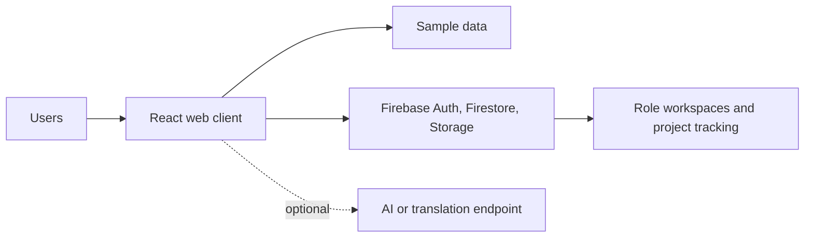

# UDBHAV

**Turning community challenges into collaborative, measurable solutions.**

## Overview

UDBHAV (Jharkhand Societal Innovation & Collaborative Intelligence Network) is a web platform concept connecting citizens and community groups with universities, industry partners, and government. Its goal is to make local challenges easier to report, review, research, and track through to potential pilots and deployment.

This repository contains the web application and Firebase client integration. It is not a deployed public service.

## Problem & Solution

Community needs can be hard to route to institutions with relevant expertise. University projects, industry support, and government programs may also run separately, making progress difficult to follow.

UDBHAV proposes a shared workflow: report a challenge with evidence and location, review it, connect collaborators, and track project milestones and reported impact. The intended value is a clearer path from local needs to practical solutions; actual outcomes depend on real-world adoption and participating organizations.

## Key Features

- Challenge reporting with evidence and location.
- Role-oriented workspaces for citizens, volunteers, students, faculty, universities, industry, and government.
- Challenge review, project and solution workflows, mentorship, and collaboration pages.
- Project progress, notifications, maps, transparency pages, and impact dashboards.
- A locally grounded challenge assistant, with an optional external AI endpoint.
- Translation integration hooks and installable web-app assets.

These are application features and interfaces, not claims of production deployment or achieved impact.


## Technology Stack

- React 18, TypeScript, and Vite
- Firebase Authentication, Cloud Firestore, and Cloud Storage (client SDK)
- Tailwind CSS
- Vitest and Testing Library
- Shared TypeScript types in `packages/shared`

## Architecture

The React web client provides public pages and role-oriented views. When configured, Firebase supplies authentication and cloud persistence; otherwise, bundled sample data supports a limited showcase experience.



There is no separate application server in this repository; Firebase operations use the browser SDK.

## Getting Started

**Prerequisites:** Node.js 20.19+ (or 22.12+) and npm. A Firebase project is needed only for sign-in and cloud persistence.

From the repository root:

```sh
npm ci --prefix JANSETU-AI-Firebase-sih2026-77922
npm run dev
```

Vite prints the local URL, normally `http://localhost:5173`. To enable Firebase, copy `JANSETU-AI-Firebase-sih2026-77922/apps/web/.env.example` to `JANSETU-AI-Firebase-sih2026-77922/apps/web/.env.local` and fill in the Firebase web-app values: `VITE_FIREBASE_API_KEY`, `VITE_FIREBASE_AUTH_DOMAIN`, `VITE_FIREBASE_PROJECT_ID`, `VITE_FIREBASE_STORAGE_BUCKET`, `VITE_FIREBASE_MESSAGING_SENDER_ID`, and `VITE_FIREBASE_APP_ID`. Analytics (`VITE_FIREBASE_MEASUREMENT_ID`), AI (`VITE_AI_API_URL`), and translation (`VITE_TRANSLATION_API_URL`) settings are optional.

Enable the authentication providers you intend to use and add authorized domains in the Firebase console. Review `firestore.rules` and `storage.rules` before deployment. To deploy rules and indexes to your own project, authenticate with Firebase CLI and run:

```sh
npm run firebase:deploy --prefix JANSETU-AI-Firebase-sih2026-77922 -- --project YOUR_FIREBASE_PROJECT_ID
```

Available checks:

```sh
npm test --prefix JANSETU-AI-Firebase-sih2026-77922
npm run typecheck --prefix JANSETU-AI-Firebase-sih2026-77922
npm run build --prefix JANSETU-AI-Firebase-sih2026-77922
```

Never place Firebase service-account credentials in this frontend. Firebase web configuration is client-visible; use your own project settings and secure access with reviewed Firebase rules. If configured, the AI endpoint receives the prompt and matching challenge context; the translation helper may send text to Google Translate when no custom endpoint is set.

## Project Structure

```text
.
├── package.json                         # Root dev-server launcher
├── README.md
└── JANSETU-AI-Firebase-sih2026-77922/
    ├── apps/web/                         # React app, assets, and tests
    ├── packages/shared/                  # Shared TypeScript types
    ├── scripts/                          # Project diagnostics
    └── firebase.json, firestore.rules,
        firestore.indexes.json, storage.rules
```

## Limitations & Future Scope

- Firebase sign-in and cloud persistence require your own configured Firebase project; without it, only the public UI and limited sample-data experience are available.
- Bundled sample records are for demonstration and **are not evidence of real-world impact**. Local fallbacks are not durable shared storage.
- External AI and translation depend on configured services. Push notification registration is not implemented.
- The Playwright configuration references end-to-end tests that are not included in this checkout.
- Future work could add end-to-end coverage, strengthen accessibility and localization testing, and validate workflows with participating organizations and consented data.

